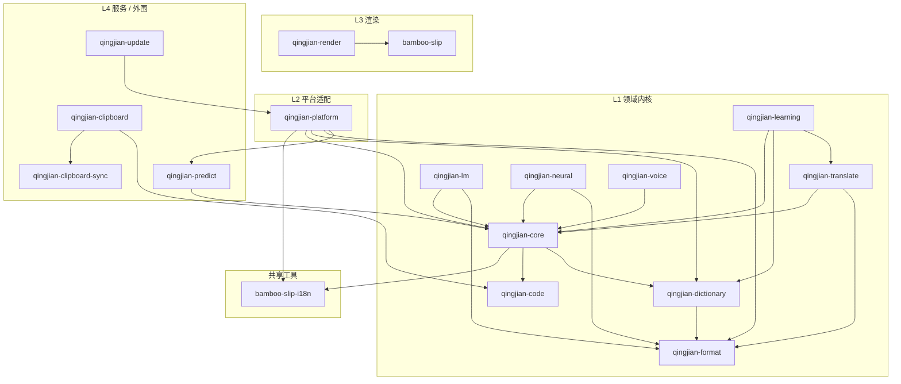
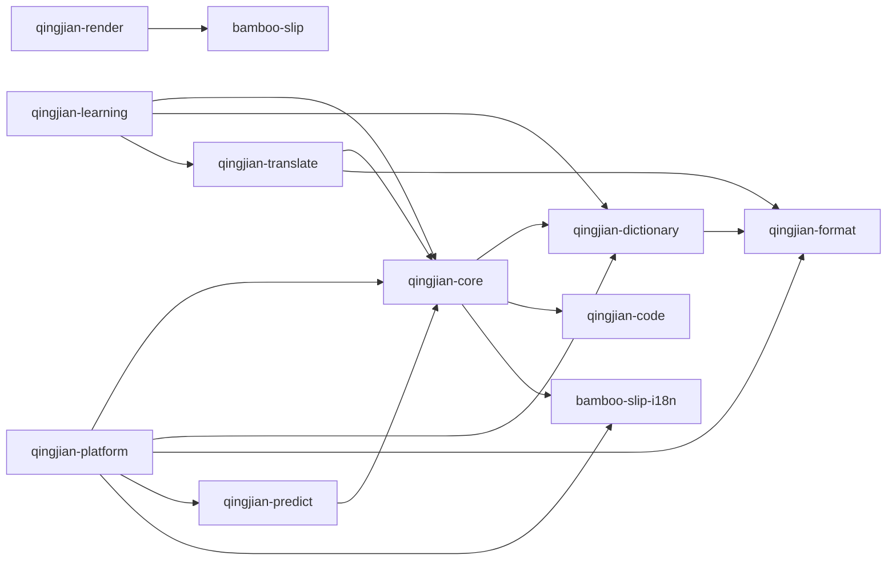

# 架构现状评估

> 本文是 2026-11-20 对 **origin/main `7de460d5`** 的一次现状评估快照，不引用任何并行分支的拆分结果。
> 所有依赖边来自 `cargo metadata --format-version 1`；所有代码统计来自仓库内 `.rs` 文件的脚本扫描；
> 统计口径与执行命令见文末附录 A。数字按当时基线冻结，main 之后前进的部分未重算。

- 基线提交：`7de460d5d67188999b321718bf0d4ea0f3a49abe`（当时的 `origin/main`；所有源码扫描均基于 `git archive 7de460d5` 导出的基线树，见附录 A）
- Workspace 成员：30 个（`crates/` 17 个 crate、`apps/` 10 个可执行包、`tools/` 3 个命令行工具），清单见根 `Cargo.toml:3-22`
- 规模：1743 个 `.rs` 文件，215,162 行（脚本按换行符切分统计，含空行）
- 测试：单元 `#[test]` 1757 个、`tests/` 集成测试 293 个（75 个集成文件）、examples 14 个

## 统计口径说明

1. **依赖数 / 被依赖数**：只统计 workspace 内部成员之间的普通依赖（`[dependencies]`）；被依赖数 = 有多少内部成员在普通依赖里引用它。`[dev-dependencies]` 单独标注。
2. **公开 API 规模**：正则扫描 `pub struct / enum / fn / trait / mod / use / type / static` 出现次数之和；`#[cfg(test)]` 模块内的项不计入。这是宽度指标，不等于实际稳定接口数。
3. **pub 字段数**：启发式统计结构体/配置体中 `pub ident:` 形式的字段行，含配置结构体，仅作量级参考。
4. **错误类型**：以源码中 `enum *Error` 声明为准，`thiserror` 派生按文件中 `thiserror::Error` / `derive(Debug, Error)` 核对。
5. 外部依赖不逐一展开，只给数量；外部依赖清单可由附录 A 的 metadata 命令复现。

---

## 1. 全貌

### 1.1 总览

| 分组 | 成员数 | `.rs` 文件 | 行数 | 单元测试 | 集成测试 | examples | pub API 项合计 |
|---|---:|---:|---:|---:|---:|---:|---:|
| `crates/` | 17 | 973 | 112,839 | 1339 | 73 | 12 | 3008 |
| `apps/` | 10 | 713 | 92,584 | 349 | 220 | 2 | 1434 |
| `tools/` | 3 | 57 | 9,739 | 69 | 0 | 0 | 132 |
| **合计** | **30** | **1743** | **215,162** | **1757** | **293** | **14** | **4574** |

### 1.2 `crates/` 一览表（17 个内部库）

| crate | 职责（取自 Cargo.toml description） | 内部依赖 | 被依赖 | 外部依赖数 | pub API | 其中 pub fn | pub(crate) | 单元 / 集成 | examples | 行数 |
|---|---|---|---:|---:|---:|---:|---:|---:|---:|---:|
| qingjian-core | 拼音输入法核心引擎：解析、候选生成、整句转换、排序与学习接口，平台无关 | i18n, code, dictionary | 17 | 8 | 1155 | 762 | 93 | 789 / 5 | 0 | 46156 |
| qingjian-dictionary | 词库：TSV 解析与 `.qj` mmap 加载，按音节位置二分查询 | format | 11 | 3 | 131 | 88 | 7 | 88 / 0 | 0 | 5515 |
| qingjian-format | `.qj` 数据容器：mmap 读取、写入、零拷贝表、文本池与哈希索引 | — | 7 | 7 | 48 | 25 | 3 | 12 / 0 | 0 | 1065 |
| qingjian-code | 认出一段文字像不像代码，切高亮片段；输入法与剪贴板共用 | — | 3 | 1 | 7 | 2 | 0 | 6 / 0 | 0 | 319 |
| bamboo-slip-i18n | 界面文案多语言：嵌入 TOML 文案表、全局界面语言与回退链 | — | 4 | 3 | 12 | 9 | 1 | 4 / 0 | 0 | 373 |
| qingjian-translate | 释义表与词汇等级表：词性 + 译词、个人释义表 | core, format | 9 | 3 | 42 | 28 | 1 | 7 / 0 | 0 | 937 |
| qingjian-learning | 本机学习数据：词频、用户词、个人 n-gram、敲错表、输入日志、词汇记录 | core, dictionary, translate | 7 | 6 | 132 | 103 | 0 | 60 / 0 | 0 | 4730 |
| qingjian-lm | 词级语言模型：二元整句打分与三元 n-gram 选词重排 | core, format | 6 | 4 | 26 | 15 | 0 | 10 / 0 | 0 | 1229 |
| qingjian-neural | 本地神经模型推理：字级 Transformer 整句打分 / 生成、知意选词模型 | core, format | 5 | 9 | 81 | 59 | 6 | 11 / 0 | 2 | 3174 |
| qingjian-voice | 云端语音识别：实现 Core 的 `Transcriber`，接火山引擎流式识别 | core | 1 | 9 | 25 | 11 | 0 | 5 / 0 | 0 | 798 |
| qingjian-predict | 云联想：OpenAI 兼容接口候选词、整句补全、问字、翻译与释义兜底 | core | 8 | 11 | 87 | 55 | 2 | 48 / 12 | 0 | 4666 |
| qingjian-platform | 平台层共用：配置文件读写、Server 与各壳协议、Windows 管道名与身份校验 | i18n, core, dictionary, format, predict | 9 | 8 | 367 | 195 | 3 | 125 / 29 | 0 | 11352 |
| bamboo-slip | 自绘 UI 引擎：场景树 + 布局 + 文字 + 动画 → 位图，平台只贴图 | — | 3 | 13 | 559 | 351 | 12 | 58 / 0 | 7 | 16248 |
| qingjian-render | 候选窗与状态条：帧数据 + 主题 → 场景树，画在 bamboo-slip 上 | bamboo-slip | 5 | 4 | 140 | 67 | 258 | 43 / 27 | 1 | 10388 |
| qingjian-clipboard | 剪贴板平台无关部分：历史存储、面板位置与配置 | clipboard-sync, code | 1 | 6 | 55 | 30 | 6 | 35 / 0 | 0 | 1982 |
| qingjian-clipboard-sync | 设备间同步：配对、加密通道、合并与局域网发现，不依赖存储和传输 | — | 3 | 9 | 103 | 52 | 14 | 25 / 0 | 1 | 3057 |
| qingjian-update | 检查更新：读 releases.json、验 ed25519 签名、按平台渠道挑新版本 | platform | 5 | 8 | 38 | 19 | 4 | 13 / 0 | 1 | 850 |

### 1.3 `apps/` 与 `tools/` 一览表

| 包 | 职责（description） | 内部普通依赖 | dev 内部依赖 | 外部依赖数 | pub API | 单元 / 集成 | 行数 |
|---|---|---|---|---:|---:|---:|---:|
| apps/android/core | Android 输入法 Rust 侧：Engine 装配 + JNI，编 `libqingjian_android.so` | clipboard-sync, core, dictionary, learning, lm, predict, render, translate, voice | i18n | 9 | 206 | 46 / 31 | 7817 |
| apps/cli | 命令行测试工具：看候选、逐键计时、回放日志评测、整句评测 | core, dictionary, learning, lm, neural, platform, predict, translate | — | 8 | 67 | 31 / 0 | 4514 |
| apps/clipboard | 全局快捷键呼出的剪贴板历史面板，可独立使用 | bamboo-slip, i18n, clipboard, clipboard-sync, code | — | 11 | 114 | 15 / 0 | 6817 |
| apps/linux/ibus | IBus 前端：按键与焦点事件转给 Server，帧交给 IBus 面板 | platform | core | 8 | 56 | 36 / 4 | 3074 |
| apps/linux/server | Linux Fcitx5 输入法 Rust Server | core, dictionary, learning, lm, neural, platform, predict, translate | — | 7 | 50 | 40 / 59 | 8115 |
| apps/macos | IMK 外壳、候选窗口、菜单与偏好设置 | core, dictionary, learning, lm, neural, platform, predict, render, translate, update | — | 14 | 450 | 45 / 2 | 18319 |
| apps/settings | 三平台共用设置程序：画在 bamboo-slip 上，读写同一份 config.toml | bamboo-slip, i18n, core, dictionary, format, learning, platform, predict, render, translate, update | clipboard (windows) | 16 | 335 | 38 / 0 | 15496 |
| apps/windows/server | Server 进程：持有 Engine，与 TSF DLL 走 IPC 通信 | core, dictionary, learning, lm, neural, platform, predict, render, translate, update | i18n | 9 | 122 | 67 / 120 | 17981 |
| apps/windows/settings | Windows 设置界面：导航栏 + 分节表单，读写 `%APPDATA%\Qingjian\config.toml` | platform, predict, core, dictionary, learning, render, translate, update | — | 5 | 0 | 1 / 0 | 3209 |
| apps/windows/tsf | TSF 文本服务 DLL：加载进应用进程，按键经 IPC 交给 Server | core, platform | windows-server | 4 | 34 | 30 / 4 | 7242 |
| tools/dict-convert | 产品数据生成：词库、语言模型、英文词表、语料挖词与 `.qj` 打包 | core, dictionary, format, lm, neural, translate | — | 9 | 93 | 58 / 0 | 7740 |
| tools/gloss-gen | LLM 批量生成释义表与多音字读音标注 | core | — | 9 | 39 | 11 / 0 | 1850 |
| tools/release-sign | 发版工具：给 releases.json 生成 ed25519 分离签名，客户端按内置公钥验 | update | — | 4 | 0 | 0 / 0 | 149 |

补充：

- `apps/linux/fcitx4/`、`apps/linux/fcitx5/` 是 C++/CMake 插件，不在 cargo workspace 成员内（根 `Cargo.toml:21` 只列了 `apps/linux/server`、`apps/linux/ibus`）。
- `tools/corpus/`（Python 语料脚本）、`tools/eval/`（`sweep.sh`）、`tools/release/`（发版 shell/python）、`tools/quality/`（质量门脚本）不是 cargo 包，不参与上面的依赖统计。
- `apps/windows/settings` 与 `tools/release-sign` 的 pub API 为 0：前者是二进制包、项全部 `pub(crate)`/模块私有（`apps/windows/settings/src/main.rs:8-15`），后者只有 `main.rs`。

---

## 2. 依赖图

### 2.1 crate 级总图（普通内部依赖）

下图边全部来自 `cargo metadata` 的 `dependencies`（`kind = null`，非 dev/build）。节点按本文第 3 章提议的分层着色。



### 2.2 局部图：core / platform / render / dictionary / learning 及其直接邻接



### 2.3 循环、反向依赖与 dev 依赖核查

| 核查项 | 结论 | 证据 / 方法 |
|---|---|---|
| 普通依赖循环 | **无环** | 对 metadata 普通内部边做 DFS 环检测，结果为空 |
| dev-dependency 环 | **无环** | 对内部 `dev-dependencies` 边做同样检测，结果为空 |
| 下层依赖上层（反向） | 存在 3 类，详见第 3.3 节 | `platform → predict`、`update → platform`、`learning → translate` |
| 可选内部依赖 | 无 | 全部内部依赖 `optional = false`（metadata 逐条核对） |
| target 限定的内部依赖 | 有：`apps/clipboard` 的 5 个内部依赖限定 `cfg(any(windows, target_os = "macos"))`；`apps/macos` 10 个限定 `cfg(target_os = "macos")`；`apps/windows/settings` 中 core/dictionary/learning/render/translate/update 限定 `cfg(windows)`（platform、predict 不限定） | 各包 `Cargo.toml` target 段，metadata `target` 字段 |
| dev 内部依赖 | `android → i18n`；`linux/ibus → core`；`settings → clipboard(windows)`；`windows/server → i18n`；`windows/tsf → windows/server` | metadata `kind = "dev"` 边 |

### 2.4 名义上是业务 crate、实际只是通用工具的成员

| crate | 实际职责 | 判据 |
|---|---|---|
| qingjian-code | 代码片段识别与高亮切分（`highlight.rs` / `kind.rs` / `span.rs`），不含输入法业务规则 | 外部依赖仅 `serde`（1 个）；5 个文件 319 行；被 core 与 clipboard 两侧复用 |
| qingjian-format | 纯二进制容器读写原语（mmap、零拷贝表、哈希索引），无领域规则 | 被 dictionary / lm / neural / translate / platform / settings / dict-convert 共 7 个成员依赖，是底层存储工具 |
| bamboo-slip-i18n | 文案目录与回退链工具，与输入法领域无关 | 4 个文件 373 行；被 core / platform / settings / clipboard-app 复用 |
| qingjian-clipboard-sync | 独立的 P2P 配对 / 加密通道 / 发现库，不依赖剪贴板存储 | 普通内部依赖为 0；外部依赖 `snow` / `spake2` / `mdns-sd` / `if-addrs` 等网络与密码学库 |

---

## 3. 分层现状判定

### 3.1 提议的四层模型

参照 `docs/design/architecture.md:1-20` 已写明的产品原则（「Core 平台无关」「平台层不做排序 / 词库 / 翻译」），结合 metadata 实际边，本文采用如下分层：

| 层 | 成员 | 职责 |
|---|---|---|
| L0 共享工具 | bamboo-slip-i18n, qingjian-format, qingjian-code | 无领域语义的通用原语，可被任意层依赖 |
| L1 领域内核 | qingjian-core, qingjian-dictionary, qingjian-translate, qingjian-learning, qingjian-lm, qingjian-neural, qingjian-voice | 输入状态机、词库、模型、学习、释义、语音；平台无关 |
| L2 平台适配 | qingjian-platform | 配置读写、壳与 Server 之间的协议类型、平台相关枚举 |
| L3 渲染 | bamboo-slip, qingjian-render | 场景树 / 栅格 / 文字 / 主题 → 位图 |
| L4 服务 / 外围 | qingjian-predict, qingjian-clipboard, qingjian-clipboard-sync, qingjian-update | 云端服务、剪贴板、同步、更新检查 |
| 组合根 | `apps/*`、`tools/*` | 装配上述 crate，不被任何 crate 反向依赖 |

### 3.2 现状符合方向的边（抽样证据）

- **L1 内部依赖方向一致**：`core → dictionary`、`dictionary → format`、`lm → core/format`、`neural → core/format`、`translate → core/format`、`learning → core/dictionary/translate`（metadata 普通边）。
- **core 不触碰平台与渲染**：在 `crates/qingjian-core/src` 下检索 `use qingjian_platform` / `use qingjian_render` / `use bamboo_slip`，命中 0 条。
- **render 不依赖 platform / core**：`crates/qingjian-render/src` 下检索 `use qingjian_platform`、`use qingjian_core`，命中 0 条；render 唯一内部依赖是 `bamboo-slip`（metadata）。
- **platform 不依赖渲染层**：`crates/qingjian-platform/src` 下检索 `use qingjian_render`、`use bamboo_slip`，命中 0 条。
- **组合根不被库反向依赖**：30 个成员中所有 `apps/*`、`tools/*` 的被依赖数均为 0（metadata reverse 表）。

### 3.3 违反方向的边（逐条证据）

| # | 边 | 方向问题 | 证据 |
|---|---|---|---|
| V1 | `platform → dictionary` | L2 适配器绕过 L1 门面，直接读词库 crate | `crates/qingjian-platform/src/code_tables/sources.rs:7`、`extra_dictionaries.rs:9`、`model_words.rs:7`、`pronunciations.rs:7`、`aux_schemes/mod.rs:12`、`code_schemes/entry.rs:6`、`aux_schemes/entry.rs:5` 等均 `use qingjian_dictionary::...` |
| V2 | `platform → format` | L2 直接依赖 L0 容器类型做模型词表装配 | `crates/qingjian-platform/src/model_words.rs:8` `use qingjian_format::Metadata`；`code_schemes/mod.rs:18` `use qingjian_format::{Container, Kind}` |
| V3 | `platform → predict` | L2 适配器依赖 L4 云服务 crate，方向倒置 | `crates/qingjian-platform/src/config/mod.rs:40` `use qingjian_predict::PredictConfig;`（platform 源码中对 predict 的唯一引用） |
| V4 | `update → platform` | L4 外围服务依赖 L2 适配器，仅为取配置枚举 | `crates/qingjian-update/src/checker/mod.rs:11`、`checker/state.rs:6`、`index/mod.rs:13` 三处 `use qingjian_platform::{UpdateChannel, UpdateConfig}` |
| V5 | `learning → translate` | L1 兄弟 crate 横向依赖：学习模块直接引用释义表的等级表类型 | `crates/qingjian-learning/src/vocabulary_book/mod.rs:21` `use qingjian_translate::LevelTable;`（测试 `vocabulary_book/tests.rs:4` 同） |
| V6 | `core → bamboo-slip-i18n` | L1 领域内核依赖 L0 工具本身可接受，但 i18n 同时被 L2 / app 使用，跨层共享；core 内该模块还是私有的 `mod i18n;`（`crates/qingjian-core/src/lib.rs:23`） | metadata 边 + `lib.rs:23` |

### 3.4 建议依赖规则清单（供后续 PR 落地）

1. **L1 不得依赖 L2 / L3 / L4**：`core` 及其兄弟领域 crate 不得 `use qingjian_platform`、`qingjian_render`、`bamboo_slip`、`qingjian_predict`、`qingjian_update`；现状已满足，需用脚本固化（见 Top10 #2）。
2. **L2 只依赖 L1 门面类型**：platform 需要的词库 / 模型词表访问应经 `core` 暴露的接口，不直接 `use qingjian_dictionary` / `qingjian_format`；V1、V2 逐条收口。
3. **配置类型下沉**：`PredictConfig`（V3）、`UpdateChannel` / `UpdateConfig`（V4）这类被 L2 与 L4 同时引用的类型，应放到 L0 共享配置 crate 或由 core 自持镜像，消除 L2↔L4 双向边。
4. **L3 只依赖 L0 / 自身**：render 可依赖 bamboo-slip 与共享类型；不得依赖 platform 的协议类型，也不得反向被 L1 引用。现状 render 未依赖 platform，保持。
5. **L4 不依赖 L2**：predict / update / clipboard 不得引用 platform；update 的平台渠道类型按规则 3 下沉。
6. **兄弟领域 crate 不横向引用**：learning 对 translate 的 `LevelTable`（V5）应改为 core 定义的中立接口，或把等级表归到 L0。
7. **apps / tools 只能经公开 API 访问 crate**：组合根可以依赖任意库，但不得进入库的私有模块（Rust 可见性已强制）；app 之间不得互相依赖（现状：仅 `windows/tsf` 在 dev-dependency 里引用 `windows/server`，普通依赖无 app→app 边）。
8. **dev 内部依赖不参与产品编译**：现 5 条 dev 边应保持 `[dev-dependencies]`，不得提升为普通依赖。

---

## 4. Feature 组织

### 4.1 Workspace 级

- 根 `Cargo.toml` **没有 `[features]` 段**；`resolver = "3"`（根 `Cargo.toml:2`）。
- 外部依赖版本统一在根 `[workspace.dependencies]` 声明，子 crate 用 `xxx.workspace = true` 引用（根 `Cargo.toml:33-129`）。

### 4.2 各 crate 的 feature 定义（metadata 原始数据）

| crate | feature | 展开内容 | 性质 |
|---|---|---|---|
| bamboo-slip | `host` | `dep:winit`、`dep:softbuffer`、`dep:arboard` | 窗口宿主可选；examples `window` 要求 `required-features = ["host"]`（`crates/bamboo-slip/Cargo.toml:38-40`） |
| qingjian-predict | `default` | `["native-tls"]` | 默认走系统 TLS |
| qingjian-predict | `native-tls` | `async-openai/native-tls` | 系统栈 TLS |
| qingjian-predict | `rustls` | `async-openai/rustls-no-provider`、`dep:rustls`、`dep:webpki-roots` | 安卓用 rustls；`rustls` / `webpki-roots` 在普通依赖里 `optional = true`（`crates/qingjian-predict/Cargo.toml:23-24,31`） |
| qingjian-neural | `default` | `[]` | 空默认，所有后端由 app 显式开启 |
| qingjian-neural | `accelerate` | `candle-core/accelerate`、`candle-nn/accelerate` | Apple Accelerate BLAS |
| qingjian-neural | `metal` | `candle-core/metal`、`candle-nn/metal` | Apple GPU |
| qingjian-neural | `zhiyi` | `[]` | 纯标记 feature |
| qingjian-neural | `zhiyi-onnx` | `zhiyi`、`dep:ort` | ONNX Runtime（Windows，动态加载）；`ort` 为 optional 依赖（`crates/qingjian-neural/Cargo.toml:21,33`） |

### 4.3 跨 crate feature 传递（app → 内部 crate）

| 组合根 | 传给内部 crate 的 feature | 来源 |
|---|---|---|
| apps/android/core | `predict/rustls` | `apps/android/core/Cargo.toml`（metadata features 字段） |
| apps/cli | `neural/zhiyi`、`neural/zhiyi-onnx` | 同上 |
| apps/macos | `neural/metal`、`neural/zhiyi` | 同上 |
| apps/windows/server | `neural/zhiyi-onnx` | 同上 |
| apps/clipboard、apps/settings | `bamboo-slip/host` | 同上 |

### 4.4 编译矩阵与膨胀点

实际存在三条正交的 feature 维度：

1. **TLS 栈**：`native-tls`（默认）× `rustls`；两套分支在源码里用 `#[cfg(all(feature = "rustls", not(feature = "native-tls")))]` 区分（CI 注释见 `.github/workflows/ci.yml:91-96`）。
2. **神经推理后端**：candle 纯 CPU × `accelerate` × `metal` × `ort(zhiyi-onnx)`；`zhiyi` 是空标记，被 `zhiyi-onnx` 顺带开启。
3. **UI 宿主**：bamboo-slip 无 `host`（纯离屏栅格）× 有 `host`（winit / softbuffer / arboard）。

观察：

- **rustls 分支测试覆盖最薄**：CI 只对 `qingjian-predict` 单跑了 `--no-default-features --features rustls` 的 clippy 与测试（`.github/workflows/ci.yml:97-101`）；android job 编 debug APK 但不跑 Rust 测试（见第 8 章），其余桌面组合仍走 native-tls。
- **后端 feature 散落在各 app 清单里**：同一台 macos 需要同时写 `metal` + `zhiyi`，windows-server 写 `zhiyi-onnx`，cli 写 `zhiyi` + `zhiyi-onnx`；缺少一处集中声明「某平台开哪些后端」。
- **`zhiyi` 空标记与 `zhiyi-onnx` 耦合**：`zhiyi-onnx = ["zhiyi", "dep:ort"]`，若将来出现非 ONNX 的知意后端，标记层需要再拆。
- 建议下沉 / 合并方向：把平台 → 后端的映射收进 workspace 级约定或 platform crate 的 cargo feature；评估 `zhiyi` 标记是否可并入 `zhiyi-onnx`；为 rustls 分支补跨 crate 的编译覆盖。

---

## 5. 公共 API 面

### 5.1 扫描结果（17 个 crate）

| crate | pub struct | pub enum | pub fn | pub trait | pub mod | pub use | pub type | pub static | pub(crate) | pub 字段(启发式) | glob 再导出 |
|---|---:|---:|---:|---:|---:|---:|---:|---:|---:|---:|---:|
| qingjian-core | 115 | 29 | 762 | 14 | 38 | 188 | 4 | 5 | 93 | 347 | 0 |
| bamboo-slip | 76 | 20 | 351 | 2 | 2 | 107 | 1 | 0 | 12 | 204 | 0 |
| qingjian-platform | 46 | 30 | 195 | 0 | 19 | 76 | 0 | 1 | 3 | 263 | 0 |
| qingjian-render | 22 | 11 | 67 | 0 | 2 | 38 | 0 | 0 | 258 | 96 | 0 |
| qingjian-dictionary | 18 | 1 | 88 | 1 | 2 | 21 | 0 | 0 | 7 | 61 | 0 |
| qingjian-learning | 12 | 1 | 103 | 0 | 1 | 15 | 0 | 0 | 0 | 22 | 0 |
| qingjian-neural | 9 | 1 | 59 | 0 | 2 | 10 | 0 | 0 | 6 | 10 | 0 |
| qingjian-clipboard-sync | 12 | 7 | 52 | 1 | 9 | 22 | 0 | 0 | 14 | 48 | 0 |
| qingjian-predict | 16 | 2 | 55 | 0 | 0 | 14 | 0 | 0 | 2 | 41 | 0 |
| qingjian-clipboard | 8 | 4 | 30 | 0 | 0 | 12 | 1 | 0 | 6 | 30 | 0 |
| qingjian-format | 5 | 4 | 25 | 0 | 2 | 12 | 0 | 0 | 3 | 17 | 0 |
| qingjian-translate | 6 | 2 | 28 | 0 | 0 | 6 | 0 | 0 | 1 | 11 | 0 |
| qingjian-update | 8 | 1 | 19 | 0 | 0 | 10 | 0 | 0 | 4 | 18 | 0 |
| qingjian-lm | 5 | 1 | 15 | 0 | 0 | 5 | 0 | 0 | 0 | 9 | 0 |
| qingjian-voice | 5 | 3 | 11 | 0 | 1 | 4 | 1 | 0 | 0 | 9 | 0 |
| qingjian-code | 1 | 1 | 2 | 0 | 0 | 3 | 0 | 0 | 0 | 2 | 0 |
| bamboo-slip-i18n | 1 | 0 | 9 | 0 | 0 | 2 | 0 | 0 | 1 | 0 | 0 |

### 5.2 过宽 / 混杂的面

- **core 的面最大**：762 个 pub fn、188 条 `pub use`、38 个 pub mod、115 个 pub struct；`pub use` 占 API 宽度的 16%，门面再导出集中在 `crates/qingjian-core/src/lib.rs:42-83`。其中两条是把内部 crate 整包别名再导出：`pub use qingjian_code as code;`（`lib.rs:7`）、`pub use qingjian_dictionary as dictionary;`（`lib.rs:76`），依赖方既可以用 `qingjian_core::code::...` 也可以直接依赖 crate，两条路径并存。
- **platform 配置体字段暴露多**：263 个启发式 pub 字段、30 个 pub enum；配置结构体（如 `GeneralConfig`）字段基本公开，读写方可以绕过访问器直接改字段。
- **render 的可见性两极分化**：140 个 pub API 项的同时有 258 处 `pub(crate)`，是全仓库 `pub(crate)` 密度最高的 crate；说明对外门面与内部实现的边界还在整理中。
- **渲染层向上泄漏引擎类型**：`crates/qingjian-render/src/lib.rs:23-24` 直接 `pub use bamboo_slip::{Color, FontLibrary, FontSpec, Pixmap, RenderError, UiFont};`（及 Windows 下 `system_fonts`），bamboo-slip 的类型穿过 render 的公开 API 暴露给壳。
- **无 glob 再导出**：全仓库 `pub use ...::*` 命中 0 条，这一点是干净的。
- **app 包的公开面不代表库接口**：macos（450）、settings（335）、android（206）的 pub 计数主要是 FFI / 事件回调结构，不是稳定库 API；windows-settings 全私有，计数为 0。
- **pub(crate) 与 pub 混用集中在壳进程**：windows-tsf 179 处 `pub(crate)`、windows-server 66、clipboard-app 44、windows-settings 42；这些包内模块划分多，但对外只暴露 FFI 入口。

---

## 6. 错误模型

### 6.1 库 crate 错误类型清单

| crate | 错误类型 | 声明位置 | thiserror 派生 | 底层转换方式 | 字符串 / 静态串变体 |
|---|---|---|---|---|---|
| qingjian-core | `ParseError` | `crates/qingjian-core/src/parser/error.rs:2` | 是（`Debug, PartialEq, Eq`） | 无 `#[from]`，纯枚举 | 无 |
| qingjian-dictionary | `DictionaryError` | `crates/qingjian-dictionary/src/error.rs:2` | 是 | `#[from] std::io::Error`、`#[from] FormatError` | `InvalidCode(String)`、`InvalidWordRule(String)`、`Line.reason: &'static str`、`Corrupt(&'static str)` |
| qingjian-format | `FormatError` | `crates/qingjian-format/src/error.rs:6` | 是 | `#[from] io::Error`、`toml::de::Error`、`toml::ser::Error` | `Malformed.reason: &'static str` |
| qingjian-translate | `GlossaryError` | `crates/qingjian-translate/src/error.rs:2` | 是 | `#[from] std::io::Error`、`#[from] FormatError` | `Line.reason: String`、`Corrupt(&'static str)` |
| qingjian-learning | `LearningError` | `crates/qingjian-learning/src/error.rs:2` | 是 | 仅 `#[from] std::io::Error` | 无；枚举只有一个 `Io` 变体 |
| qingjian-lm | `LmError` | `crates/qingjian-lm/src/error.rs:4` | 是 | `#[from] std::io::Error`、`#[from] FormatError` | `file/reason: &'static str` 字段 |
| qingjian-neural | `NeuralError` | `crates/qingjian-neural/src/error.rs:6` | 是 | `#[from] FormatError`、`#[from] candle_core::Error`；`Io`/`Json` 用结构体字段带 `source` | `Onnx(String)`、`Corrupt(&'static str)` |
| qingjian-predict | `PredictError` | `crates/qingjian-predict/src/error.rs:4` | 是 | `#[from] std::io::Error`、`#[from] OpenAIError`、`#[from] serde_json::Error` | `MissingApiKey(String)` |
| qingjian-voice | `VoiceError` | `crates/qingjian-voice/src/error.rs:6` | 是 | `#[from] tungstenite::Error` | `Connect(String)`、`Server.message: String`、`Protocol(&'static str)`；另带 `describe()` 给用户看的文案 |
| qingjian-platform | `ConfigError` | `crates/qingjian-platform/src/error.rs:6` | 是 | 结构体字段 `#[source]`；`toml` 错误用 `Box<toml::de::Error>` / `Box<toml_edit::TomlError>` 装箱（注释说明为压 clippy 128 字节阈值） | 无字符串变体 |
| qingjian-platform | `CodecError` | `crates/qingjian-platform/src/protocol/codec.rs:14` | 是 | 协议编解码错误 | 见源码 |
| qingjian-render | `ThemeError` | `crates/qingjian-render/src/theme/error.rs:4` | 是 | 主题加载 / 解析 | 见源码 |
| qingjian-render | `PreviewError` | `crates/qingjian-render/src/preview/error.rs:8` | 是 | 预览渲染 | 见源码 |
| qingjian-render | `ShotError` | `crates/qingjian-render/src/preview/error.rs:23` | 是 | 截图导出 | 见源码 |
| bamboo-slip | `RenderError` | `crates/bamboo-slip/src/error.rs:6` | 是 | 栅格 / 文字排版 | 见源码 |
| bamboo-slip | `HostError` | `crates/bamboo-slip/src/host/error.rs:4` | 是 | 窗口宿主 | 见源码 |
| qingjian-clipboard | `ClipboardError` | `crates/qingjian-clipboard/src/error.rs:4` | 是 | 存储 / 配置 | 见源码 |
| qingjian-clipboard-sync | `SyncError` | `crates/qingjian-clipboard-sync/src/error.rs:6` | 是 | **手写 `impl From<snow::Error>`（丢弃 source，映射成 `Handshake`）**；手写 `impl From<serde_json::Error>`（转成 `Protocol(error.to_string())`，无 source 链） | `Protocol(String)`、`Storage(String)` |
| qingjian-update | `UpdateError` | `crates/qingjian-update/src/error.rs:5` | 是 | `#[from] reqwest::Error`、`#[from] std::io::Error`、`#[from] serde_json::Error` | 无字符串变体 |

### 6.2 app / tool 错误类型

`AndroidError`（apps/android/core）、`CliError / TuneError / ColdError / EvalError / ReplayError`（apps/cli）、`IbusError`（apps/linux/ibus）、`ServerError`（apps/linux/server）、`HostError`（apps/macos）、`ServerError`（apps/windows/server）、`ClientError`（apps/windows/tsf）、`ConvertError`（tools/dict-convert）、`GlossError`（tools/gloss-gen）、`SignError`（tools/release-sign）。

### 6.3 不统一的点

1. **命名后缀两套**：多数叫 `XxxError`，但 `SyncError`、`HostError`（bamboo-slip 与 macos 各一）、`CodecError` 用的是业务名词；同名 `HostError` / `ServerError` 跨 crate 重复出现，跨 crate 转换时容易混淆。
2. **source 链保留程度不一**：主流用 `#[from]` 或 `#[source]` 保留底层错误；`SyncError` 的两个手写 `From` 把 `snow::Error` 直接丢成无信息变体、把 `serde_json::Error` 压成 `String`（`clipboard-sync/src/error.rs:28-38`），丢了原始 cause。
3. **字符串变体与类型变体混用**：dictionary / translate / neural / predict / voice / sync 都有 `String` 或 `&'static str` 变体；同类「配置非法」在有的 crate 是带 source 的结构体，在有的 crate 是一条字符串。
4. **core 没有统一错误类型**：core 对外只有 `parser::ParseError`；其他失败路径直接返回 `std::io::Error`、`Option` 或布尔状态，没有 crate 级错误枚举，跨 crate 边界只能靠各调用方自己包一层。
5. **learning 错误壳过薄**：`LearningError` 只有一个 `Io` 变体（`learning/src/error.rs:2-8`），学习文件格式问题按设计「只跳过不报错」，与 dictionary / translate 的行级错误粒度不一致。
6. **无 anyhow**：17 个库 crate 扫描 `anyhow` 命中 0；`Box<dyn Error>` 只出现在 `apps/clipboard/examples/render_tray_icon.rs:23,65,93` 三个示例函数签名里，库边界没有动态错误类型。
7. **app 层仍有字符串错误**：`apps/settings/src/jobs/download/fetch.rs:31,49,50` 返回 `Result<(), String>` / `Result<T, String>`，解析错误也是字符串，未落到类型化错误。

---

## 7. 线程 / 异步边界

### 7.1 并发原语统计（库 crate）

| crate | Arc | Mutex | RwLock | RefCell | std 线程 | tokio 引用 | channel | block_on | OnceLock/OnceCell/thread_local | unsafe |
|---|---:|---:|---:|---:|---:|---:|---:|---:|---:|---:|
| qingjian-core | 44 | 22 | 0 | 13 | 10 | 0 | 7 | 0 | 2 | 1 |
| qingjian-platform | 2 | 0 | 1 | 0 | 0 | 0 | 0 | 0 | 0 | 31 |
| qingjian-render | 21 | 0 | 0 | 0 | 0 | 0 | 0 | 0 | 4 | 0 |
| qingjian-dictionary | 0 | 0 | 0 | 0 | 0 | 0 | 0 | 0 | 0 | 0 |
| qingjian-format | 6 | 0 | 0 | 0 | 0 | 0 | 0 | 0 | 0 | 2 |
| qingjian-learning | 0 | 0 | 0 | 0 | 0 | 0 | 0 | 0 | 0 | 0 |
| qingjian-lm | 0 | 0 | 0 | 0 | 0 | 0 | 0 | 0 | 0 | 1 |
| qingjian-neural | 2 | 2 | 0 | 0 | 1 | 0 | 0 | 0 | 4 | 8 |
| qingjian-translate | 0 | 0 | 0 | 0 | 0 | 0 | 0 | 0 | 0 | 0 |
| qingjian-predict | 2 | 0 | 0 | 0 | 14 | 11 | 24 | 10 | 0 | 0 |
| qingjian-voice | 5 | 0 | 0 | 0 | 2 | 0 | 5 | 0 | 2 | 0 |
| qingjian-clipboard | 0 | 0 | 0 | 0 | 0 | 0 | 0 | 0 | 0 | 0 |
| qingjian-clipboard-sync | 12 | 9 | 0 | 0 | 20 | 0 | 6 | 0 | 0 | 0 |
| qingjian-update | 3 | 1 | 0 | 0 | 2 | 1 | 0 | 1 | 0 | 0 |
| bamboo-slip | 18 | 3 | 0 | 4 | 0 | 0 | 0 | 0 | 5 | 8 |
| bamboo-slip-i18n | 0 | 1 | 1 | 0 | 0 | 0 | 0 | 0 | 3 | 0 |

app / tool 侧参考：linux-server thread 7 / channel 11；windows-server thread 6 / mutex 2 / channel 8；clipboard-app thread 29 / channel 7；macos RefCell 30、unsafe 208；windows-tsf RefCell 16、unsafe 199；ibus tokio 5、async fn 34；gloss-gen tokio 7、async fn 6、block_on 3；settings tokio 3、async fn 4、block_on 2。

### 7.2 异步边界现状

- **core 是纯同步、无运行时**：tokio 引用 0、`async fn` 0；后台工作用 std 线程池：`crates/qingjian-core/src/engine/choice/worker.rs:27` 与 `engine/rescoring/worker.rs:53` 用 `std::thread::Builder` 起打分线程，经 channel 回传结果（core channel 7 处）。
- **异步只出现在服务 crate 与壳**：库内 `async fn` 共 4 个——predict 3 个（`chat_client/mod.rs`）、update 1 个（`index/fetch.rs`）；其余 async 集中在 ibus（34）、settings（4）、gloss-gen（6）。
- **同步门面里内嵌 tokio 运行时（block_on 桥接）**：predict / update / settings / gloss-gen / ibus 都是在自己的工作线程里建 current-thread 运行时，再 `block_on` 调异步客户端。证据：
  - `crates/qingjian-predict/src/worker/mod.rs:96,100,111`：worker 循环里 `runtime.block_on(self.client.complete(...))` / `block_on(async { JoinSet ... })` / `block_on(jobs.join_next())`
  - `crates/qingjian-predict/src/gloss/worker.rs:115`、`gloss/phrase/worker.rs:116`、`chat_client/mod.rs:563`
  - `crates/qingjian-update/src/index/fetch.rs:16-19`：`Builder::new_current_thread()...build()?` 后 `runtime.block_on(async { ... })`
  - `apps/settings/src/jobs/download/fetch.rs:37,53`：下载线程里 `runtime.block_on(download(...))` / `block_on(first_ok(...))`
  - `tools/gloss-gen/src/main.rs:47,56,63`、`apps/linux/ibus/src/main.rs:90`
- **未发现 `async fn` 内部直接调 `block_on`**：上述 block_on 均位于同步函数 / 线程入口；但 predict 的 worker 模型是「std 线程持有 tokio Handle」，跨线程传递的是 `Predictor` 请求 / 响应与客户端克隆（`Arc` 2 处），需要保持这条边界不被 async 代码渗透。
- **RefCell 的线程风险点**：RefCell 出现在 core（13）、bamboo-slip（4）、macos（30）、windows-server（15）、tsf（16）、clipboard-app（4）。RefCell 不是 `Send`，这些使用必须留在单线程（UI 线程 / 宿主线程）；macos / tsf 的高 RefCell 数量与 FFI 边界相邻，是后续审查重点。
- **unsafe 集中在平台壳**：macos 208、tsf 199、windows-server 131、clipboard-app 111、android 105；库 crate 内 unsafe 很少（core 1、render 0、dictionary 0）。

### 7.3 注入点（trait / 闭包 / 泛型）

core 对外暴露 14 个 `pub trait`，全部带 `Send`（部分 `Send + Sync`），是库与服务 crate 之间的唯一接缝：

| core trait | 实现方（生产代码） |
|---|---|
| `Predictor` | `qingjian-predict/src/cloud_predictor.rs:70` |
| `Transcriber` | `qingjian-voice/src/volcengine/transcriber.rs:31` |
| `LanguageModel` | `qingjian-lm/src/bigram_model.rs:288`、`trigram/language_model.rs:7`、`mixed_model.rs:38` |
| `SentenceScorer` | `qingjian-neural/src/hanzhang/core_scorer.rs:12,42` |
| `ChoiceModel` | `qingjian-neural/src/zhiyi/choice_model.rs:7` |
| `Translator` | `qingjian-translate/src/layered_translator.rs:35`、`glossary/mod.rs:300` |
| `Learner` | `qingjian-learning/src/frequency_learner/learner_impl.rs:51` |
| `PanelHistory` | `qingjian-learning/src/panel_usage.rs:88` |
| 其余 `InputLogger`、`VocabularyTracker`、`SwipeDecoder`、`GlossFiller`、`PhraseModel`、`UsageMeter` | core 内空实现 / 测试替身，生产实现待补 |

闭包注入：`impl Fn*` 出现次数 predict 5、render 6、bamboo-slip 18、core 19；`Box<dyn ...>` 形式 core 36、windows-server 8、macos 5、neural 4。trait object 与闭包接缝目前分散在各门面方法参数里，没有统一的装配接口（见 Top10 #10）。

---

## 8. 测试分层现状

### 8.1 按 crate / 包统计

| 包 | 单元 `#[test]` | 集成测试（`tests/`） | 集成文件数 | examples |
|---|---:|---:|---:|---:|
| qingjian-core | 789 | 5 | 3 | 0 |
| qingjian-platform | 125 | 29 | 5 | 0 |
| qingjian-render | 43 | 27 | 14 | 1 |
| qingjian-predict | 48 | 12 | 5 | 0 |
| qingjian-dictionary | 88 | 0 | 0 | 0 |
| qingjian-learning | 60 | 0 | 0 | 0 |
| qingjian-neural | 11 | 0 | 0 | 2 |
| qingjian-lm | 10 | 0 | 0 | 0 |
| qingjian-translate | 7 | 0 | 0 | 0 |
| qingjian-format | 12 | 0 | 0 | 0 |
| qingjian-voice | 5 | 0 | 0 | 0 |
| qingjian-clipboard | 35 | 0 | 0 | 0 |
| qingjian-clipboard-sync | 25 | 0 | 0 | 1 |
| qingjian-update | 13 | 0 | 0 | 1 |
| qingjian-code | 6 | 0 | 0 | 0 |
| bamboo-slip | 58 | 0 | 0 | 7 |
| bamboo-slip-i18n | 4 | 0 | 0 | 0 |
| apps/android/core | 46 | 31 | 6 | 0 |
| apps/cli | 31 | 0 | 0 | 0 |
| apps/clipboard | 15 | 0 | 0 | 1 |
| apps/linux/ibus | 36 | 4 | 2 | 0 |
| apps/linux/server | 40 | 59 | 18 | 0 |
| apps/macos | 45 | 2 | 1 | 0 |
| apps/settings | 38 | 0 | 0 | 0 |
| apps/windows/server | 67 | 120 | 20 | 0 |
| apps/windows/settings | 1 | 0 | 0 | 0 |
| apps/windows/tsf | 30 | 4 | 1 | 1 |
| tools/dict-convert | 58 | 0 | 0 | 0 |
| tools/gloss-gen | 11 | 0 | 0 | 0 |
| tools/release-sign | 0 | 0 | 0 | 0 |
| **合计** | **1757** | **293** | **75** | **14** |

补充：

- 集成测试高度集中在壳进程：windows-server 120 个 / 20 文件、linux-server 59 / 18、render 27 / 14、platform 29 / 5、android 31 / 6；多数领域 crate（dictionary、learning、lm、neural、translate、format、voice、clipboard、sync、update）没有 `tests/` 目录，行为验证全靠 src 内联单元测试。
- `#[tokio::test]` 仅 4 个，全在 `apps/linux/ibus/tests/`（`ibus_engine.rs` 3 个、`ibus_engine/code.rs` 1 个）。
- examples 分布：bamboo-slip 7、neural 2、render / sync / update / clipboard-app / tsf 各 1。

### 8.2 CI 实际跑了什么（`.github/workflows/ci.yml`）

| Job | 平台 | 执行内容 |
|---|---|---|
| `core` | ubuntu-26.04 | `cargo fmt --all --check`（:56）；`cargo deny check`（:70）；`cargo clippy --workspace --exclude qingjian-macos --all-targets`（:89）；predict rustls 特性 clippy + test（:98,:101）；`cargo doc --no-deps --workspace --exclude macos`（:108）；`cargo test --workspace --exclude macos`（:111）；构建 linux-server（:114）；fcitx5 / fcitx4 CMake 构建 + ctest（:117-153）；shell 脚本 `bash -n` 与 `installation.py`（:156,:162） |
| `release` | ubuntu-26.04 容器外 | `cargo clippy --release --workspace --exclude macos --all-targets`（:212），补 release profile 视角 |
| `shellcheck` | ubuntu-26.04 | 所有 `*.sh` 静态检查，warning 级以上（:227） |
| `macos` | macos-26 | `clippy -p qingjian-macos` + `test -p qingjian-macos`（:249,:252） |
| `linux-22_04` | ubuntu:22.04 容器 | 构建 `linux-server` + `settings`（:298）；`cargo test --workspace --exclude macos`（:302） |
| `android` | ubuntu-26.04 | 仅 Gradle `assembleDebug`（:341）；**不跑 cargo test / clippy** |
| `windows` | windows-latest | clippy + doc + test：platform、windows-server、tsf、windows-settings、settings、clipboard-app（:363,:369,:372）；tsf 32 位 clippy（:380） |

缺口：

- android 壳只编 APK，Rust 侧测试与 lint 不在门禁内（CI 注释 :93-96 也承认 rustls 分支主要靠 android 顺带编译）。
- 14 个 examples 没有独立测试任务；只随 `--all-targets` 被 clippy 编译。
- 领域 crate 缺少集成测试，`tests/` 门禁对 dictionary / learning / lm / neural 等不构成约束。

---

## 9. Top 10 结构性问题（按影响排序）

| # | 问题 | 证据 | 建议归属（后续 PR） |
|---|---|---|---|
| 1 | **qingjian-core 单体过大**：337 文件 / 46,156 行 / 1155 个 pub API（762 pub fn、188 pub use、38 pub mod）；大块集中在 `engine/`（`engine/mod.rs` 798 行、`engine/commit/mod.rs` 752 行、`engine/setup/mod.rs` 723 行） | 第 5.1 节表；脚本统计；`crates/qingjian-core/src/engine/` 目录 | PR-A：core 拆分门面 + 子领域 crate（parser / candidate / ranking / sentence / engine 装配），先固化公开再导出面 |
| 2 | **platform 绕过 core 直连领域数据 crate**（V1/V2）：L2 适配器直接 `use qingjian_dictionary` / `qingjian_format`，词库与容器类型泄漏进平台层 | `platform/src/code_tables/sources.rs:7`、`extra_dictionaries.rs:9`、`model_words.rs:7-8`、`pronunciations.rs:7` 等 | PR-B：依赖规则脚本化固化（第 3.4 节清单）+ platform 收口到 core 门面类型 |
| 3 | **L4 服务反向依赖 L2 平台层**（V4）：update 仅为 `UpdateChannel` / `UpdateConfig` 依赖 platform；同类配置类型被 L2/L4 双向引用 | `update/src/checker/mod.rs:11`、`checker/state.rs:6`、`index/mod.rs:13` | PR-C：共享配置类型下沉 L0，update 摘掉 platform 依赖 |
| 4 | **platform 依赖云服务 crate**（V3）：适配器层引用 predict 的 `PredictConfig`，方向倒置且把 TLS/网络配置语义带进平台层 | `platform/src/config/mod.rs:40`（platform 源码唯一 predict 引用） | PR-C 同批：配置类型下沉，platform 不再依赖 predict |
| 5 | **渲染层类型泄漏 + 可见性混杂**：render 公开再导出 bamboo-slip 的 `Color / Pixmap / FontLibrary / RenderError` 等；258 处 `pub(crate)` 与 140 个 pub 项并存 | `render/src/lib.rs:23-24`；第 5.1 节表 | PR-D：render 门面只暴露自己的帧 / 主题类型，引擎类型经 impl 或新类型封装 |
| 6 | **错误模型不统一**：命名两套、source 链在 `SyncError` 手写 From 处丢失、String 变体与类型变体混用、core 无统一错误类型、app 层仍返回 `Result<_, String>` | 第 6.1、6.3 节；`clipboard-sync/src/error.rs:28-38`、`settings/src/jobs/download/fetch.rs:31,50` | PR-E：错误约定 ADR（命名 / From / source / 字符串变体禁令），逐 crate 迁移 |
| 7 | **并发与异步边界混杂**：core std 线程池 + 22 Mutex / 13 RefCell；predict/update/settings 在 worker 线程 `block_on` 桥接；RefCell 散落在 macos(30) / tsf(16) / windows-server(15) 等 FFI 邻接包 | 第 7.1、7.2 节；`core/src/engine/choice/worker.rs:27`、`rescoring/worker.rs:53`；`predict/src/worker/mod.rs:96,100,111` | PR-F：线程模型文档化；审查 RefCell 的 Send 边界；把 block_on 桥接收敛到单一运行时装配点 |
| 8 | **feature 编译矩阵分散、覆盖不均**：TLS 双栈 / 神经后端 / host 三条维度由各 app 清单手写；rustls 仅 predict 单测；`zhiyi` 空标记与 `zhiyi-onnx` 耦合；android 不跑 Rust 测试 | 第 4.3、4.4 节；`.github/workflows/ci.yml:97-101,:341` | PR-G：平台 → 后端映射集中声明；补 rustls 跨 crate 编译与 android cargo test 门禁 |
| 9 | **测试分层不均，领域 crate 缺集成测试**：293 个集成测试里 179 个在 windows-server / linux-server（120 + 59）；dictionary、learning、lm、neural、translate、format、voice 等无 `tests/` 目录；14 个 examples 无独立门禁 | 第 8.1 节表 | PR-H：为领域 crate 补 `tests/` 黑盒用例；examples 纳入 CI 编译 / 快照检查 |
| 10 | **组合根直接依赖过多内部 crate，缺统一装配门面**：settings 依赖 11 个内部 crate、macos 10、windows-server 10、android 9；14 个 core trait 与闭包 / trait object 接缝散落在各门面方法 | 第 1.3 节表；第 7.3 节 trait 清单 | PR-I：提供 Engine 装配门面（composition root），app 只依赖门面 + 必要渲染 / 服务 trait，收敛直连边 |

---

## 附录 A：实际执行过的统计命令与脚本

环境（每条 PowerShell 命令都是新进程，需重新设置）：

```powershell
$env:CARGO_TARGET_DIR='E:\qj-msvc-arch'
& 'C:\Users\lbx13\.cargo\bin\cargo.exe' +1.96.0-x86_64-pc-windows-msvc <args>
```

1. 基线核对：

```powershell
git rev-parse HEAD
git rev-parse origin/main
git status --short
git branch --show-current
```

2. 依赖与 feature 解析（离线优先，失败再去掉 `--offline`）：

```powershell
cargo metadata --format-version 1 --offline
```

   脚本 `analyze_metadata.py` 据此提取：成员清单、普通 / dev / build 内部依赖边、被依赖反向表、feature 定义、target 限定、可选依赖，并做普通边与 dev 边的 DFS 环检测。

3. 源码扫描脚本 `scan_sources.py`（按 `.rs` 文件逐行正则统计）：
   - pub 项：`pub struct|enum|fn|trait|mod|use|type|static`（排除 `#[cfg(test)]` 模块）
   - 测试：`#[test]`、`#[tokio::test]`；`tests/` 目录递归计集成测试；`examples/` 递归计文件数
   - 错误：`enum *Error` 声明、`thiserror::Error` 派生、`impl From<...>`、`anyhow`、`Box<dyn Error>`、字符串变体
   - 并发：`Arc` / `Mutex` / `RwLock` / `RefCell` / `std::thread` / `tokio::` / channel / `block_on` / `OnceLock` / `unsafe` / `async fn` / `Box<dyn>` / `impl Fn`
4. 聚合脚本 `aggregate.py`：合并 metadata 与扫描结果，按 crates / apps / tools 分组求和，生成第 1、5、8 章表格数字。
5. 补充人工核对（Grep / Read）：core 对 platform/render/bamboo 的 `use` 引用（0 命中）；render 对 platform/core 的 `use` 引用（0 命中）；platform 对 predict 的引用（1 处）；各错误枚举文件内容；CI workflow 全文。

> 复现注意：pub 字段数与部分宽度计数是正则启发式，口径见正文「统计口径说明」；行数按换行符切分，含空行。脚本与中间 JSON 保存在本次任务的 agent 工作区，未写入仓库。
